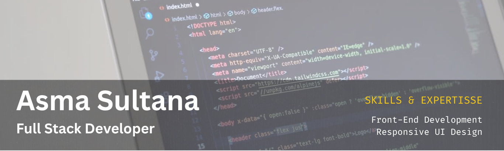

  
<h3 align="center">
  
</h3>
  
## About me
I'm a Full-Stack Developer with hands-on expertise in React, Next.js, Node.js, TypeScript, and MongoDB. I build everything from visually appealing front-end interfaces to secure and scalable back-end systems, following modern standards like JavaScript (ES6+) and RESTful APIs.

- 🧠 Currently learning and practicing **Full Stack Web Development**.
- 🔍 Looking for opportunities to grow as a **Junior Developer or Engineer** and contribute to real-world projects.
- ⚡ Focused on learning fast, building practical solutions, and contributing to real products. I love blending design with code to transform ideas into engaging and meaningful digital experiences. My journey in tech is ongoing, as I continually seek to learn and enhance my skills.

## Skills & Technologies  

| **Category** | **Tech Stack** |
|:---|:---|
| **Programming Languages** |       |
| **Frontend Development** |         |
| **Backend Development** |     |
| **Database & Authentication** |       |
| **AI/ML & Data Science** |    `NumPy` `Pandas` `Matplotlib` `AI Integration` |
| **Tools & Design** |        |
 

 ##  Reach me at   
 

## My GitHub Stats

    
    
 

 

  
 

 
